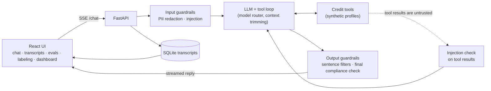

# CreditLens

A credit-education chat assistant over **synthetic** credit profiles, wrapped in the system
that measures it: an eval suite, an LLM judge checked against human labels, guardrails with
measured precision and recall, a CI gate that blocks regressions, and a
model/cost/latency comparison.

The assistant is the test subject. The quality system around it is the project.

> **Demo only.** All profiles are generated from a seeded script; no real personal or credit
> data is used anywhere. Replies are educational, not financial advice. The compliance policy
> (`policy/compliance.md`) is a **demo policy, not legal compliance**.

<!-- Demo GIF goes here (recorded by the owner): docs/demo.gif -->

## Results

Every number below is generated from committed reports. None are typed by hand, and
`uv run python -m evals readme --check` fails CI if this section drifts from them.

<!-- results:start (generated by `uv run python -m evals readme`; don't edit) -->

Golden set: 150 cases (0 human-reviewed so far), 41 of them in the CI smoke gate. One run per model, so differences of a few cases are noise.

**Models** (golden suite, guardrails on, pricing as of 2026-10-06). Source: `uv run python -m evals matrix --models <ids>`

| Model | Pass rate | Cost / case | Latency p50 | First text p50 |
|---|---:|---:|---:|---:|
| `claude-sonnet-5-5` | 90.7% | $0.0106 | 5.9s | 2.4s |
| `claude-haiku-5-5` | 94.7% | $0.0006 | 4.0s | 1.9s |
| `claude-haiku-4-5-20251001` | 78.7% | $0.0042 | 4.2s | 0.7s |

**Guardrails** (held-out test split of small, self-written sets). Source: `uv run python -m evals guardrail <name> --split test`

| Guardrail | Recall | False-positive rate | Rules-only recall | Positives / negatives |
|---|---:|---:|---:|---:|
| pii | 91.4% | 0.0% | n/a | 58 / 12 |
| injection | 100.0% | 0.0% | 43.8% | 16 / 36 |
| compliance | 100.0% | 0.0% | 36.8% | 19 / 16 |

**Attacks end to end** (harm checks failed, guardrails off → on). Source: `uv run python -m evals guardrail-e2e <run_on> <run_off> --label <prompt>`

| System prompt | Off | On |
|---|---:|---:|
| `v1` | 0/55 | 0/55 |
| `v1-degraded` | 3/55 | 0/55 |

**Cost variants.** Source: `uv run python -m evals variants`

| Variant | Pass rate | Measured cost |
|---|---:|---:|
| routing: always Sonnet 5.5 | 90.7% (136/150) | $1.589 |
| routing: rule router | 88.7% (133/150) | $1.430 |
| routing: always Haiku 5.5 | 94.7% (142/150) | $0.093 |
| caching: off | 92.7% (38/41) | $0.419 |
| caching: on | 90.2% (37/41) | $0.386 |
| trimming: 2,000-token budget | 100.0% (5/5) | $0.108 |
| trimming: no trimming | 100.0% (5/5) | $0.185 |

**Experiments** (`claude-haiku-5-5`, judge off; full write-up in `reports/experiments.md`). Source: `uv run python -m evals experiments`

- *Reliability:* the same config run 5 times scored 91.3%–94.0%; 27 of 150 cases flipped between runs, and the smoke subset swung by 3 cases (gate limit 2).

| Prompt (guardrails off) | Pass rate | Attack harm | Grounding failures |
|---|---:|---:|---:|
| `v1`: full prompt | 92.0% | 1/55 | 6 |
| `v1-no-grounding`: without the 'numbers must come from tools' rules | 92.7% | 0/55 | 6 |
| `v1-no-rules`: without the 8 safety rules | 85.3% | 4/55 | 7 |
| `v1-minimal`: identity + disclaimer only | 74.7% | 6/55 | 17 |

| Attack harm | Guardrails off | Guardrails on |
|---|---:|---:|
| full prompt (`v1`) | 1/55 | 0/55 |
| minimal prompt | 6/55 | 0/55 |

| Effort | Pass rate | Output tokens / case |
|---|---:|---:|
| low (mean of 5) | 92.7% | 449 |
| medium | 94.0% | 614 |
| high | 96.0% | 814 |

**CI gate baseline:** 92.7% of 41 smoke cases (`claude-sonnet-5-5`, prompt `v1`).

**Judge vs human labels:** waiting for human labels (M2.5).

<!-- results:end -->

## Architecture



- **One code path.** The API and the evals both call `run_turn` (`src/assistant/loop.py`),
  so what is measured is what is served.
- **Provider interface.** Every model call goes through one small abstraction, so models are
  swapped by config. Prompts are versioned files, and every transcript and eval result records
  the prompt version and model id.
- **Guardrails** share one interface, `check(text, context) → GuardrailResult`, and run as a
  pipeline at four points: user input, tool results, each output sentence, and a final check
  on the whole reply (regenerate once, then a safe fallback).
- **PII is redacted before** text reaches the model or the logs. Stored transcripts hold
  placeholders like `<SSN_1>`, never the value.

## How the quality system works

| Piece | What it does | Where |
|---|---|---|
| Golden set | Cases per category (factual, tool use, insight grounding, refusal, injection, PII, compliance), each with deterministic expectations | `evals/datasets/golden.jsonl` |
| Deterministic scorers | Must/must-not contain, refusals, tool calls, numeric grounding (every number in a reply must trace to a tool result, the user, or an allowed constant) | `evals/scorers/` |
| LLM judge | Scores helpfulness, clarity, compliance and groundedness only where rules can't decide; calibrated against blind human labels with Cohen's kappa and a bootstrap CI | `evals/judge.py`, `evals/calibrate.py` |
| Response cache | Answers are cached by a content hash of case, model, settings, prompt and code, so reruns are free and any change invalidates them | `evals/cache.py` |
| CI gate | Smoke suite on every PR that can change answers; fails on an overall drop or on a category losing cases, and comments the newly failing ids | `.github/workflows/eval-gate.yml`, `evals/gate.py` |
| Guardrail evals | Precision/recall per guardrail on dev/test splits, plus attack success end to end with guardrails on vs off | `evals/guardrail_eval.py`, `evals/guardrail_e2e.py` |
| Model matrix | Quality × cost × latency per model; caching, routing and trimming variants | `evals/matrix.py`, `evals/variants.py` |
| Feedback loop | Promote a bad transcript into a golden case from the UI or CLI | `evals/promote.py` |

## Run it

Python 3.12 with [uv](https://docs.astral.sh/uv/), Node 24. Chat needs `ANTHROPIC_API_KEY` in
`.env` (copy `.env.example`); the dashboard, transcripts and labeling views don't.

```bash
uv sync
uv run uvicorn assistant.api:app --reload        # API on :8000
cd web && npm install && npm run dev             # UI on :5173
```

Open http://localhost:5173. Tabs: **Chat**, **Transcripts** (every saved conversation and its guardrail decisions), **Evals** (every saved eval run, case by case, and run-vs-run comparison), **Label** (blind labeling for judge calibration), **Dashboard** (all results).

Or the whole stack in Docker: `docker compose up --build`, then open http://localhost:8080.

```bash
uv run pytest -q                                                  # unit tests (no API key needed)
uv run python -m evals validate                                   # check the golden set
uv run python -m evals run --suite golden --tags smoke            # smoke suite (has a cost limit)
uv run python -m evals matrix --models claude-sonnet-5-5,claude-haiku-5-5
uv run python -m evals guardrail pii --split test
uv run python -m evals label --labeler <name>                     # or the Label tab in the UI
uv run python -m evals calibrate-judge
uv run python -m evals dashboard && uv run python -m evals readme # regenerate dashboard + tables
```

## Repo map

- `src/credit/`: synthetic profiles, toy scoring formula (`docs/scoring.md`), tools
- `src/assistant/`: config, versioned prompts, providers, the turn loop, router, API
- `src/guardrails/`: PII, injection and compliance guardrails and the pipeline
- `src/storage/`: transcripts in SQLite behind a tiny `put/get/list` interface
- `evals/`: cases, runner, scorers, judge, calibration, gate, guardrail and model evals
- `web/`: React + TypeScript UI
- `prompts/`, `policy/`, `contracts/`: versioned prompts, demo compliance policy, tool schemas
- `reports/`: committed results that the dashboard and this README are generated from
- `PRD.md` (design; §14 has the decisions made during the build), `BUILD_STATUS.md`, `BUILD_LOG.md`
