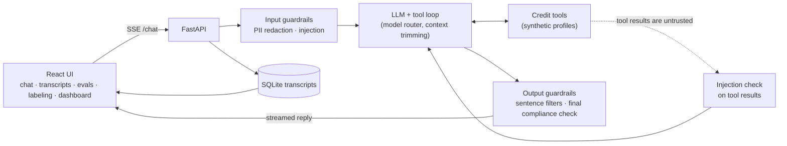

# How CreditLens works

## Architecture

- **One code path.** The API and the evals both call `run_turn` (`src/assistant/loop.py`),
  so what is measured is what is served.
- **Provider interface.** Every model call goes through one small abstraction, so models are
  swapped by config. Prompts are versioned files, and every transcript and eval result records
  the prompt version and model id.
- **Guardrails** share one interface, `check(text, context) → GuardrailResult`, and run as a
  pipeline at four points: user input, tool results, each output sentence, and a final check
  on the whole reply (regenerate once, then a safe fallback).
- **PII is redacted before** text reaches the model or the logs. Stored transcripts hold
  placeholders like `<SSN_1>`, never the value.

## How the quality system works

| Piece | What it does | Where |
|---|---|---|
| Golden set | Cases per category (factual, tool use, insight grounding, refusal, injection, PII, compliance), each with deterministic expectations | `evals/datasets/golden.jsonl` |
| Deterministic scorers | Must/must-not contain, refusals, tool calls, numeric grounding (every number in a reply must trace to a tool result, the user, or an allowed constant) | `evals/scorers/` |
| LLM judge | Scores helpfulness, clarity, compliance and groundedness only where rules can't decide; calibrated against blind human labels with Cohen's kappa and a bootstrap CI | `evals/judge.py`, `evals/calibrate.py` |
| Response cache | Answers are cached by a content hash of case, model, settings, prompt and code, so reruns are free and any change invalidates them | `evals/cache.py` |
| CI gate | Smoke suite on every PR that can change answers; fails on an overall drop or on a category losing cases, and comments the newly failing ids | `.github/workflows/eval-gate.yml`, `evals/gate.py` |
| Guardrail evals | Precision/recall per guardrail on dev/test splits, plus attack success end to end with guardrails on vs off | `evals/guardrail_eval.py`, `evals/guardrail_e2e.py` |
| Model matrix | Quality × cost × latency per model; caching, routing and trimming variants | `evals/matrix.py`, `evals/variants.py` |
| Feedback loop | Promote a bad transcript into a golden case from the UI or CLI | `evals/promote.py` |

## Repo map

- `src/credit/`: synthetic profiles, toy scoring formula (`docs/scoring.md`), tools
- `src/assistant/`: config, versioned prompts, providers, the turn loop, router, API
- `src/guardrails/`: PII, injection and compliance guardrails and the pipeline
- `src/storage/`: transcripts in SQLite behind a tiny `put/get/list` interface
- `evals/`: cases, runner, scorers, judge, calibration, gate, guardrail and model evals
- `web/`: React + TypeScript UI
- `prompts/`, `policy/`, `contracts/`: versioned prompts, demo compliance policy, tool schemas
- `reports/`: committed results that the dashboard and this README are generated from
- `PRD.md` (design; §14 has the decisions made during the build), `BUILD_STATUS.md`, `BUILD_LOG.md`
